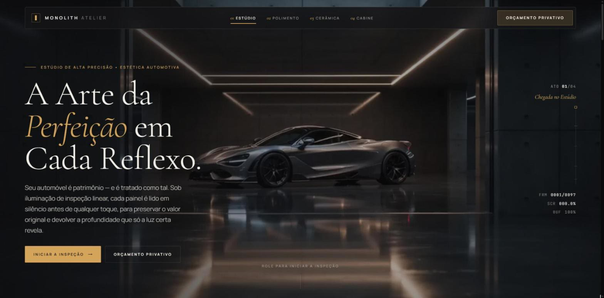
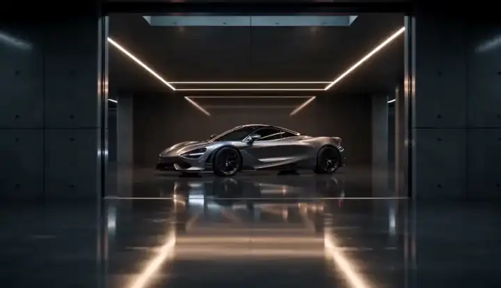
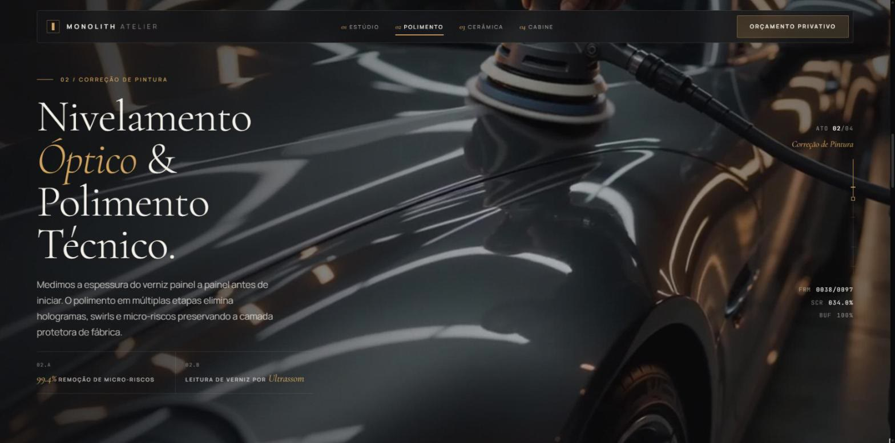
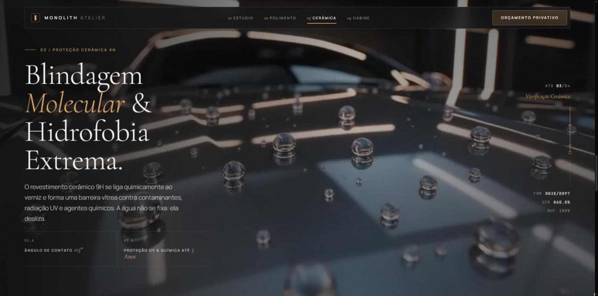
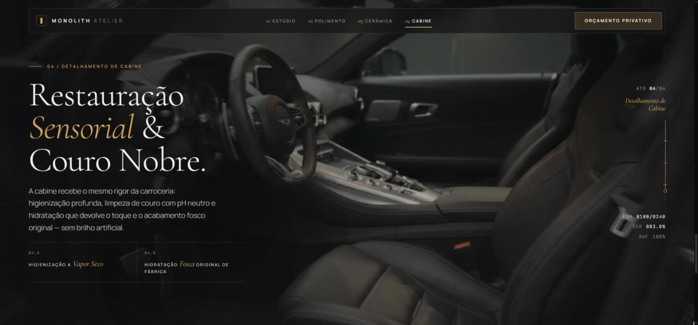
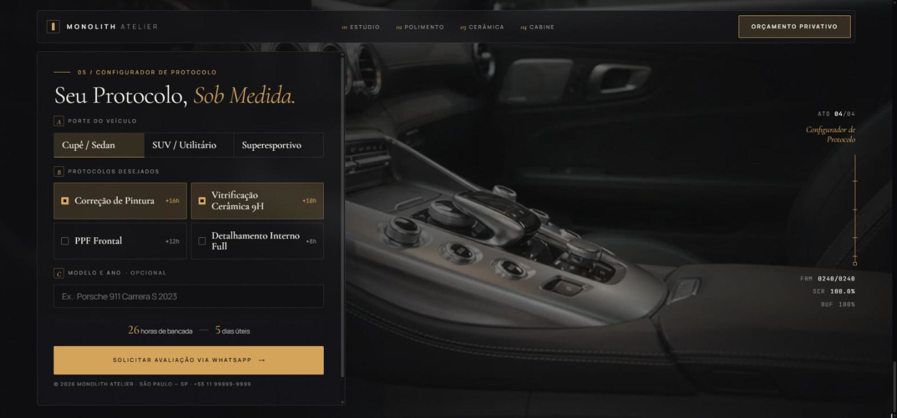
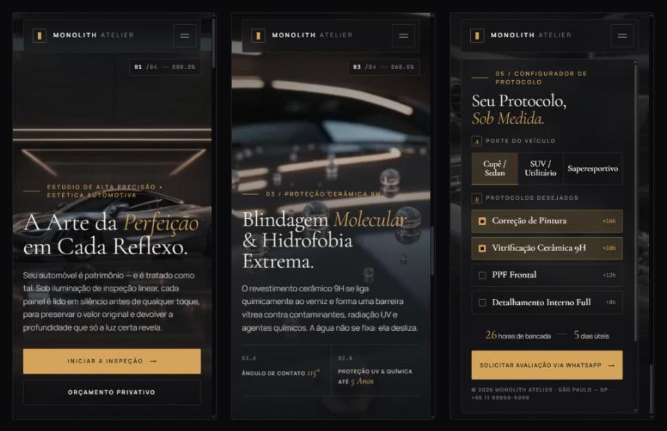

<div align="center">



<br />
<br />

# MONOLITH ATELIER

**Estética Automotiva & Proteção Cerâmica de Alta Precisão**

Site cinematográfico *white-label* para estúdios de estética automotiva de alto padrão.<br />
Quatro vídeos viram uma narrativa contínua em scroll — renderizada frame a frame em Canvas.

<br />

[**Ver demo ao vivo →**](https://jhosuetortolero-lgtm.github.io/monolith-atelier/)

<br />


[](https://github.com/jhosuetortolero-lgtm/monolith-atelier/actions/workflows/deploy.yml)

</div>

<br />

## A experiência

O visitante rola a página e o carro **chega ao estúdio, recebe o polimento, a vitrificação cerâmica e o detalhamento da cabine** — tudo em uma única linha do tempo de 800vh, com crossfades entre os atos, textos editoriais sincronizados ao frame e, no final, um configurador que envia o orçamento pronto para o WhatsApp.

<div align="center">
  
  <br />
  <sub>Os quatro atos em sequência (prévia acelerada dos frames).</sub>
</div>

<br />

<table>
  <tr>
    <td width="50%"></td>
    <td width="50%"></td>
  </tr>
  <tr>
    <td align="center"><sub><b>02</b> · Nivelamento Óptico & Polimento Técnico</sub></td>
    <td align="center"><sub><b>03</b> · Blindagem Molecular & Hidrofobia Extrema</sub></td>
  </tr>
  <tr>
    <td width="50%"></td>
    <td width="50%"></td>
  </tr>
  <tr>
    <td align="center"><sub><b>04</b> · Restauração Sensorial & Couro Nobre</sub></td>
    <td align="center"><sub><b>05</b> · Configurador de Protocolo → WhatsApp</sub></td>
  </tr>
</table>

| Ato | Faixa do scroll | Cena | Mensagem |
| :-: | :-- | :-- | :-- |
| **01** | 0 – 24% | Chegada no estúdio | *A Arte da Perfeição em Cada Reflexo.* |
| **02** | 24 – 50% | Correção de pintura | *Nivelamento Óptico & Polimento Técnico.* |
| **03** | 50 – 76% | Vitrificação cerâmica | *Blindagem Molecular & Hidrofobia Extrema.* |
| **04** | 76 – 93% | Detalhamento de cabine | *Restauração Sensorial & Couro Nobre.* |
| **05** | 93 – 100% | Frame final + vinheta | Configurador de protocolo com tempo de estúdio em tempo real |

<br />

## Destaques

- **Scroll-scrub cinematográfico** — 531 frames WebP desenhados em Canvas High-DPI (`dpr ≤ 2`) com `object-fit: cover` real e ponto focal por ato; crossfades com dissolve + *push-in* entre as cenas.
- **Movimento natural em qualquer tela** — inércia normalizada por tempo (`k = 1 − (1 − lerp)^(dt·60)`), idêntica em 60, 90 e 120 Hz; blend sub-frame entre frames vizinhos elimina os “degraus” de 24 fps.
- **Carregamento em duas fases** — o Preloader libera a experiência só com o Ato 1 completo; os Atos 2–4 chegam em segundo plano por passes de *stride* (8 → 4 → 2 → 1), então o scrub funciona antes do download terminar.
- **Feito para celular** — conjunto próprio de frames 960px (~45% do peso), scroll nativo com o momentum do iOS/Android, `safe-area` do notch, inputs sem zoom no iPhone, layouts para retrato, paisagem e tablet.
- **Conversão** — configurador de porte + protocolos com estimativa de horas de bancada e dias de permanência; o CTA abre o WhatsApp com a mensagem formatada.
- **White-label de verdade** — textos, protocolos, tempos, WhatsApp e SEO em **um único arquivo**; um script refaz frames e manifesto a partir dos vídeos de qualquer cliente.
- **Zero 404** — o manifesto é gerado contando os arquivos reais; o motor nunca pede um frame que não existe.
- **Acessível** — `prefers-reduced-motion`, `inert` nos blocos fora de cena, `aria-live` na estimativa, foco visível.

<br />

## No celular

<div align="center">
  
</div>

<br />

## Começando

```bash
git clone https://github.com/jhosuetortolero-lgtm/monolith-atelier.git
cd monolith-atelier
npm install
npm run dev
```

Os frames já estão no repositório (`public/frames` e `public/frames-mobile`). Para regerá-los a partir de novos vídeos é preciso ter **FFmpeg** no PATH.

| Comando | O que faz |
| :-- | :-- |
| `npm run dev` | Servidor de desenvolvimento |
| `npm run build` | Build de produção em `dist/` |
| `npm run preview` | Serve o build localmente |
| `npm run check` | `svelte-check` + `tsc` (0 erros, 0 warnings) |
| `npm run frames` | Extrai frames desktop + mobile, gera `og-image.jpg` e o manifesto |
| `npm run frames:manifest` | Só reconta os frames e regenera o manifesto |

<br />

## Personalizar para um novo estúdio

1. **Vídeos** — coloque `video_auto01` … `video_auto04` (`.mp4`, `.mov` ou `.webm`) na raiz do projeto ou na pasta-pai.

   | Vídeo | Ato |
   | :-- | :-- |
   | `video_auto01` | Chegada no estúdio |
   | `video_auto02` | Correção de pintura |
   | `video_auto03` | Vitrificação cerâmica |
   | `video_auto04` | Detalhamento interno |

2. **Frames** — `npm run frames` (ou `npm run frames -- --src="D:/videos/cliente"`).
3. **Conteúdo** — edite só [`src/lib/config/studioConfig.ts`](src/lib/config/studioConfig.ts): marca, cidade, **WhatsApp**, textos dos atos, palavras em destaque, portes, protocolos, horas e `seo.siteUrl`.
4. **Enquadramento** — se o carro não estiver centralizado no vídeo, ajuste `focusX`/`focusY` do ato em `CHOREOGRAPHY` ([`ScrollCanvasEngine.ts`](src/lib/engine/ScrollCanvasEngine.ts)).
5. **Validar** — `npm run check && npm run build`.

> O guia completo (arquitetura, regras de design e regras de celular que não podem regredir) está em [`CLAUDE.md`](CLAUDE.md).

<br />

## Arquitetura

```
scripts/build-frames.mjs                    FFmpeg → WebP (desktop + mobile) → og-image → manifesto
src/
├── App.svelte                              Orquestra canvas fixo, trilho de 800vh e camadas de UI
├── app.css                                 Design system (tokens, tipografia, botões)
└── lib/
    ├── config/
    │   ├── studioConfig.ts                 Configuração white-label única
    │   └── framesManifest.ts               GERADO — contagens exatas por ato e conjunto
    ├── engine/
    │   ├── ScrollCanvasEngine.ts           Motor Canvas + CHOREOGRAPHY (fonte única da linha do tempo)
    │   └── smoothScroll.ts                 Lenis + GSAP ScrollTrigger
    ├── state/experience.svelte.ts          Estado global (runes): progresso, ato, frame, buffer
    ├── utils/quote.ts                      Estimativa de horas/dias + mensagem do WhatsApp
    └── components/
        ├── Preloader.svelte                Barra dourada 1px + contador 000 — 100%
        ├── Navbar.svelte                   Header flutuante, navegação por atos, drawer mobile
        ├── TelemetryHud.svelte             ATO 01/04 · FRM · SCR · BUF
        ├── SectionsOverlay.svelte          Camada editorial à esquerda + configurador final
        └── ProtocolConfigurator.svelte     Porte + protocolos → tempo real → wa.me
```

**Fluxo:** o Lenis suaviza a roda do mouse → o ScrollTrigger mede o progresso do trilho → o motor aplica inércia e desenha o frame → o progresso suavizado alimenta textos, HUD e navegação. Tudo lê a mesma `CHOREOGRAPHY`, então canvas e tipografia nunca saem de sincronia.

<br />

## Design system

Dark architectural · automotive luxury — concreto escuro e luz linear quente.

| Token | Cor | Uso |
| :-- | :-- | :-- |
| `--bg-obsidian` |  | Fundo |
| `--text-ivory` |  | Texto principal |
| `--text-muted` |  | Texto secundário |
| `--accent-amber` |  | Destaques, CTAs, itálicos |

- **Tipografia** — *Cormorant Garamond* nos títulos (com uma palavra em itálico âmbar), *Manrope* no texto e nos rótulos espaçados, *JetBrains Mono* só na telemetria.
- **Forma** — linhas de 1px, cantos de 2–4px, superfícies com `backdrop-filter: blur(18px)`, grão de filme sutil.
- **Regra de ouro** — o texto vive à esquerda sobre um degradê escuro e nunca cobre o centro do veículo.

<br />

## Deploy

Cada push na `main` publica automaticamente no **GitHub Pages** via [GitHub Actions](.github/workflows/deploy.yml): `npm ci` → `npm run check` → `npm run build` com `BASE_PATH=/<repo>/`.

Para outro domínio, defina `BASE_PATH` no build (ou deixe `/`) e atualize `seo.siteUrl` em `studioConfig.ts` — é o que gera a prévia com imagem quando o link é compartilhado no WhatsApp.

<br />

---

<div align="center">
  <sub>MONOLITH ATELIER é uma marca de demonstração deste template. © 2026 — todos os direitos reservados.</sub>
</div>
